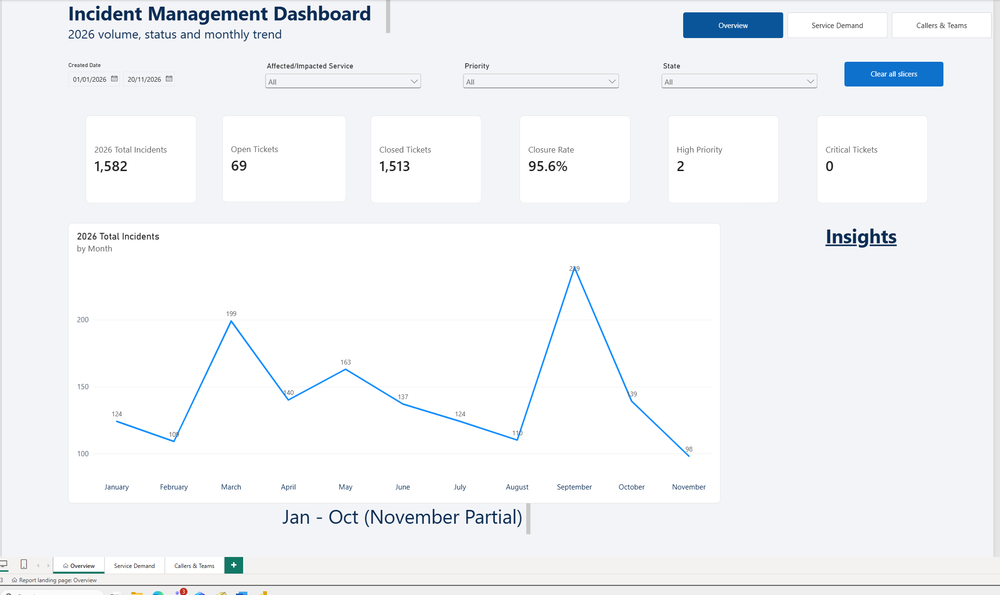
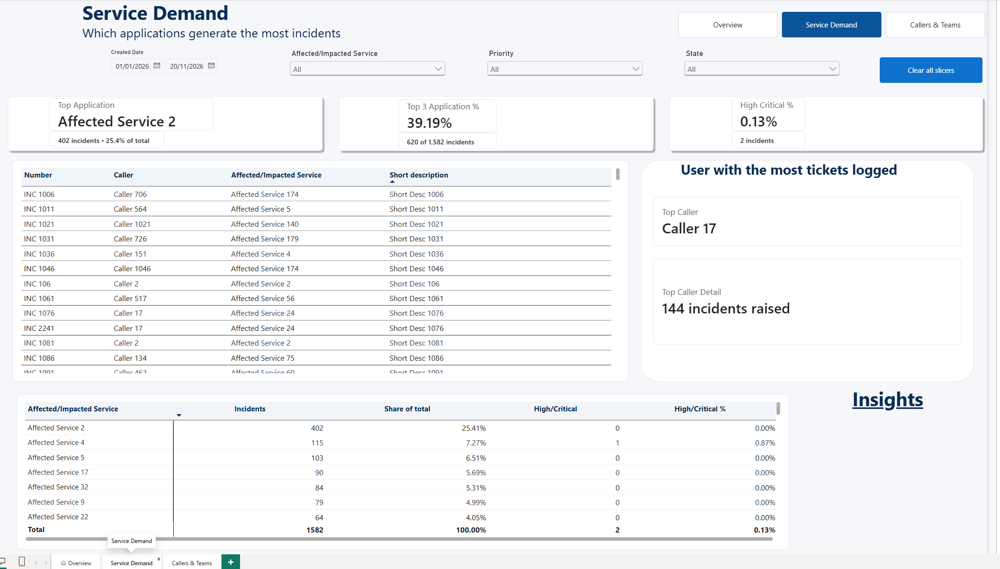
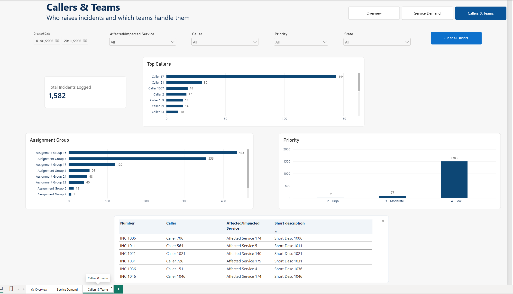

# ServiceNow Incident Analysis

## Project Overview

This project uses Power BI to analyse ServiceNow incident data and provide a clearer view of IT support demand across applications, users and support teams.

The report is structured across three reusable analytical pages. *Overview* provides headline KPIs and monthly incident trends. *Service Demand* explores which affected services generate the most incidents and how concentrated that demand is. *Callers & Teams* examines who is raising incidents, how tickets are distributed across assignment groups, and the priority profile of support demand.

Rather than focusing solely on total ticket volumes, this project has been designed to identify patterns in where incidents originate, which services generate the most support demand, and where further investigation and process improvements may be valuable.

## Project Objectives

The report was developed to:

- Develop reusable KPIs for monitoring incident demand.
- Monitor overall incident volumes and how demand changes over time.
- Measure how much of the total incident demand is concentrated within the highest-volume services.
- Identify callers responsible for the greatest number of incidents logged.
- Analyse how incidents and workloads are distributed across assignment groups.
- Understand the priority profile of incidents across the support workload.
- Use these patterns to highlight recurring service issues, areas for deeper investigation and opportunities for process improvement.

## Business Questions

### Overall Incident Demand

1. How does incident volume change month by month?
2. How many incidents are currently open versus closed?
3. How many high-priority or critical incidents are being raised?

### Service Demand

1. Which affected services generate the highest number of incidents?
2. How much of total incident demand is concentrated within the highest-volume services?
3. Are particular services generating disproportionately high support demand?

### Callers & Teams

1. Which anonymised callers are raising the most incidents?
2. How concentrated is incident demand among the highest-volume callers?
3. Which assignment groups are handling the largest incident volumes?
4. How is incident priority distributed across the support workload?

## Tools Used

- Power BI
- DAX
- Power Query
- Excel
- ServiceNow export data

## Dataset

The original analysis was developed using approximately 7,910 ServiceNow incident records from 2026. The dataset included fields such as incident date, status, priority, affected/impacted service, caller and assignment group.

The original organisational dataset is not included in this public portfolio. A synthetic dataset is provided in `DemoSnowData.xlsx` to demonstrate the structure of the data without exposing organisational or personal information.

## Data Preparation

Before building the report, the incident data was reviewed and prepared for analysis. This included:

- Validating data types, particularly incident date fields.
- Checking for blank or inconsistent values.
- Standardising fields used for grouping and filtering.
- Checking for duplicate records where appropriate.
- Validating row counts after transformation.
- Reviewing fields for confidential or personally identifiable information before publication.

Power Query was used to prepare the data before it was loaded into the Power BI model.

## Power BI Dashboard

The dashboard is separated into three analytical pages so that high-level monitoring and deeper analysis can be performed without overcrowding a single report page.

### Overview

The *Overview* page provides a high-level view of incident demand using headline KPIs and monthly incident trends.

The page allows overall support activity to be monitored while providing visibility of open and closed incidents, closure rate, higher-priority incidents and changes in demand throughout the reporting period.

### Service Demand

The *Service Demand* page focuses on identifying which affected services generate the greatest incident demand.

The analysis provides visibility of the highest-volume affected service, the number and proportion of incidents associated with that service, and how incident demand is distributed across other affected services.

This provides a starting point for identifying services where recurring incidents or concentrated demand may justify further investigation.

### Callers & Teams

The *Callers & Teams* page explores where incidents originate and how support demand is distributed across callers and assignment groups.

Caller analysis highlights which anonymised users are responsible for the highest incident volumes, while assignment group analysis shows where support workload is concentrated. Priority analysis provides additional context around the type of incidents being handled.

## DAX

DAX measures were created to support the KPIs and analysis used throughout the report.

These include measures for overall incident volumes, filtered incident counts and service-level analysis. Representative measures and explanations are documented in [`dax/measures.md`](dax/measures.md).

Separating the calculations into measures allows the report to respond dynamically to slicers and filters while keeping KPI calculations consistent across report pages.

## Analytical Interpretation

The dashboard is designed to identify patterns and areas that may require further investigation rather than treating incident volume alone as evidence of a problem.

For example, a service generating a high number of incidents may represent an area of concern, but the volume could also be influenced by the number of users, transaction volumes or how widely the service is used.

Similarly, a caller raising a high number of incidents does not necessarily indicate incorrect system use. The analysis identifies where demand originates so that the underlying reasons can be investigated further.

This distinction is important when using operational support data to make business decisions.

## Key Findings

The analysis provides visibility of several important patterns in support demand:

- Incident demand changes throughout the reporting period rather than remaining constant month by month.
- Affected services can be ranked by incident volume to identify where support demand is most concentrated.
- Service-level contribution measures provide additional context by showing how much of overall demand is associated with the highest-volume services.
- Caller analysis highlights where incident demand is concentrated among anonymised users.
- Assignment group analysis shows how incident workload is distributed across support teams.
- Priority analysis provides context around the severity profile of the overall incident workload.

These findings are intended to identify areas for further investigation rather than establish root cause directly.

## Limitations

The analysis also has several limitations that should be considered when interpreting the results:

- Incident volume alone does not measure application reliability.
- High-volume services may also have larger user populations or transaction volumes.
- Caller volumes should not be interpreted as individual performance or behaviour.
- Assignment group data may represent ticket routing rather than the team that ultimately resolved an incident.
- The current dataset covers 2026 and therefore does not establish longer-term trends.
- Additional categorisation and resolution data would support deeper root-cause and service-performance analysis.

## Potential Next Steps

The analysis could be extended further by:

- Analysing resolution time by priority and affected service.
- Identifying recurring incident categories and common issue types.
- Comparing incident demand with application user populations.
- Investigating repeat incidents and high-frequency issues.
- Analysing whether knowledge articles or automation could reduce common support requests.
- Comparing multiple years of incident data to identify longer-term trends and seasonality.
- Adding resolution and service-level metrics to understand whether high-volume services also experience longer resolution times.

## Skills Demonstrated

This project demonstrates practical experience in:

- Power BI report development
- DAX
- Power Query
- Data cleaning and validation
- KPI development
- Operational data analysis
- Data visualisation
- Analytical interpretation
- Business problem solving
- Data confidentiality and anonymisation

## Repository Structure

- `data/` - Synthetic example data used to demonstrate the dataset structure.
- `dax/` - Representative DAX measures and explanations.
- `docs/` - Supporting methodology and project documentation.
- `screenshots/` - Sanitised screenshots of the Power BI report.

## Data Confidentiality

This project is based on analysis of operational support data. The original organisational dataset is not included in the public repository.

The public version uses anonymised screenshots and synthetic sample data so that the analytical approach can be demonstrated without exposing employee details, incident identifiers, confidential ticket information, internal system information or other organisational data.
